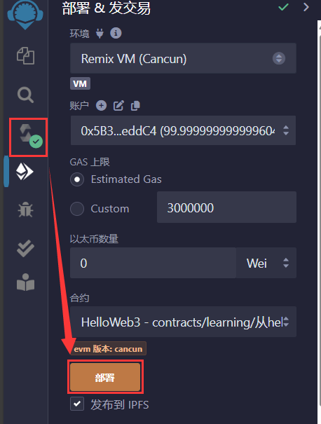
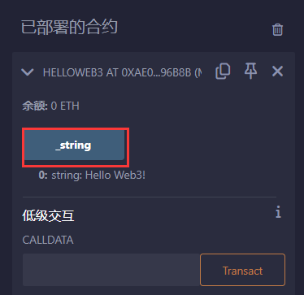

# 1.从Hello Web3 开始

## 一、Solidity简述

**Solidity有如下两个特点：**

- 面向智能合约

  Solidity提供了丰富的智能合约功能，包括状态变量（用于存储合约状态）、函数（用于定义合约的行为），事件（用于与外部应用程序通信）和修饰器（用于修改函数的行为）等。

- 静态类型

  Solidity是静态类型的语言，每个变量的类型都需要在编译器确定，这有助于在编程阶段发现错误。

## 二、开发工具：remix

https://remix.ethereum.org/

## 三、第一个Solidity程序

```solidity
// SPDX-License-Identifier: MIT   //标明这个代码所用的软件许可证（license），这里面用的是MIT许可证，也是Solidity合约默认使用的开源许可证，如果不写许可，编译时会警告，但程序可以运行
pragma solidity ^0.8.4; //声明源文件所用的Solidity版本，因为不同版本的语法有所差别，不允许小于0.8.4版本的编译器编译
contract HelloWeb3 {//创建合约，声明合约名字为HelloWeb3
    string public _string = "Hello Web3!";
}
```

`Ctrl+S`编译，点击部署按钮：



点击`_string`测试：

