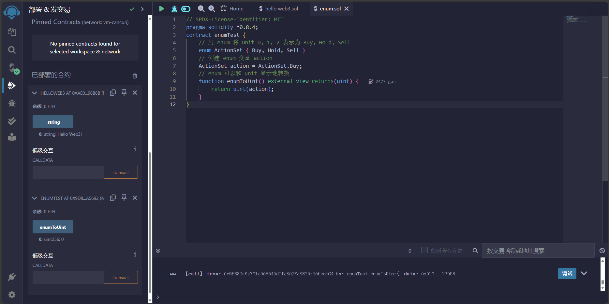
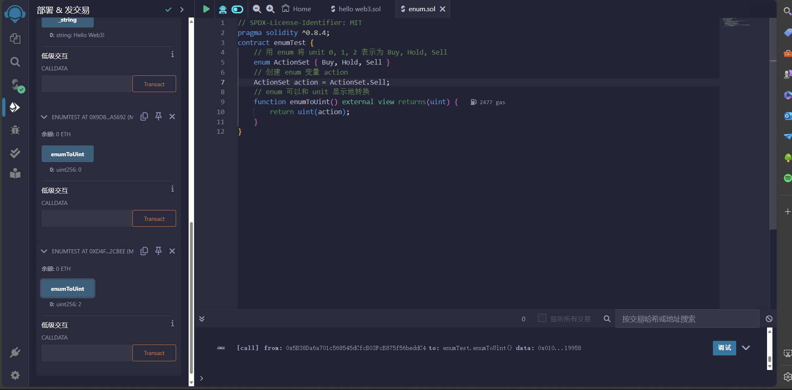

# 2.值类型

Solidity语言中的变量类型主要包括以下三种：

1. 值类型：包括布尔型和整型。这类变量在赋值时直接传递数值。
2. 引用类型：包括数组和结构体。这类变量占用的存储空间较大，在赋值的时候直接传递变量的地址（类似C语言中的指针）。
3. 映射类型：Solidity中存储键值对的数据结构，可以理解为哈希表。

## 一、布尔型

布尔型是二元变量，取值为`true`或`false`。

```solidity
// 布尔值
bool public _bool = true;
```

注意：&&和||两个运算符的机制和其他许多语言中的类似，遵循所谓**短路规则**。

## 二、整形

`int` / `uint`: 分别表示有符号和无符号的不同位数的整型变量。 关键字 `uint8` 到 `uint256` （无符号整型，从 8 位到 256 位）以及 `int8` 到 `int256`， 以 8 位为步长递增。 `uint` 和 `int` 分别是 `uint256` 和 `int256` 的别名。

运算符：

- 比较运算符： `<=`， `<`， `==`， `!=`， `>=`， `>` （返回布尔值）
- 位运算符： `&`， `|`， `^` (异或)， `~` (位取反)
- 移位运算符： `<<` （左移）， `>>` （右移）
- 算数运算符： `+`， `-`， 一元运算 `-` （只适用于有符号的整数）， `*`， `/`， `%` (取余)， `**` (幂)

## 三、地址

地址分为以下两类：

- 普通地址：存储一个20字节的值（长度为以太坊地址的长度）
- 付款地址：比普通地址多了`transfer`和`send`两个成员方法，用于接收转账

## 四、字节数组

### 1.定长字节数组

属于值类型，根据每个元素存储数据的大小分为`bytes1`、`bytes2`、`...`、`bytes32`等一系列类型。每个元素最多存储32字节的数据。数组长度在声明之后不能改变。

```solidity
// 定长字节数组
bytes32 public _byte32 = "MiniSolidity";
bytes1 public _byte = _byte32[0];
```

### 2.不定长字节数组

属于引用类型，数组长度在声明之后可以改变，包括`bytes`等。

## 五、枚举

主要用于为`unit`类型的值分配名称，使程序易于阅读和维护，使用名称来代表一些类从0开始的`unit`类型的值。

```solidity
// 用 enum 将 unit 0, 1, 2 表示为 Buy, Hold, Sell
enum ActionSet { Buy, Hold, Sell }
// 创建 enum 变量 action 
ActionSet action = ActionSet.Buy;
// enum 可以和 unit 显示地转换
function enumToUint() external view returns(uint) {
	return uint(action);
}
```



