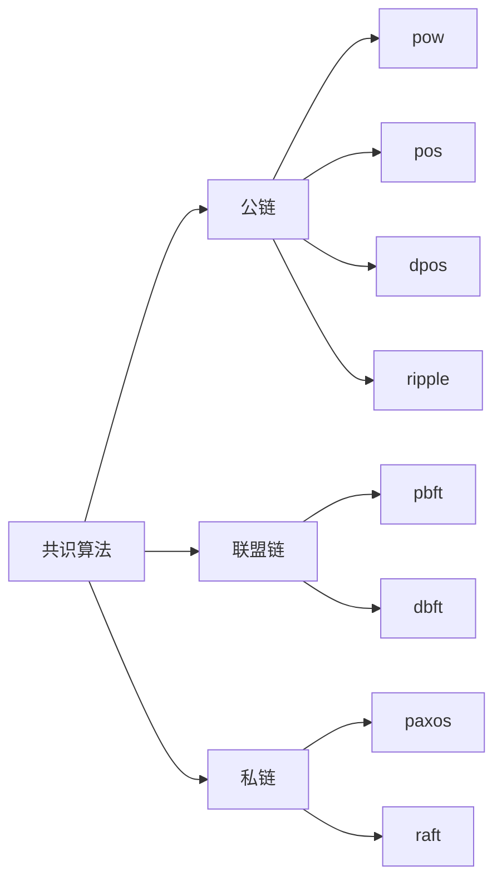
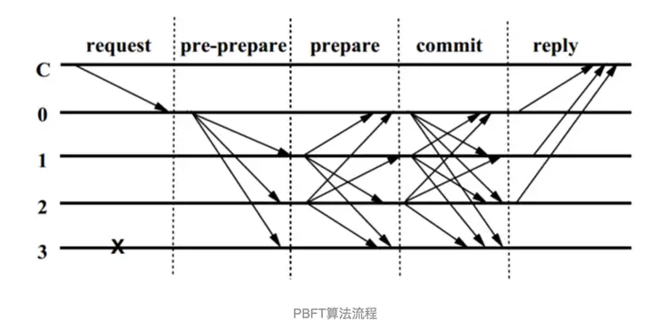
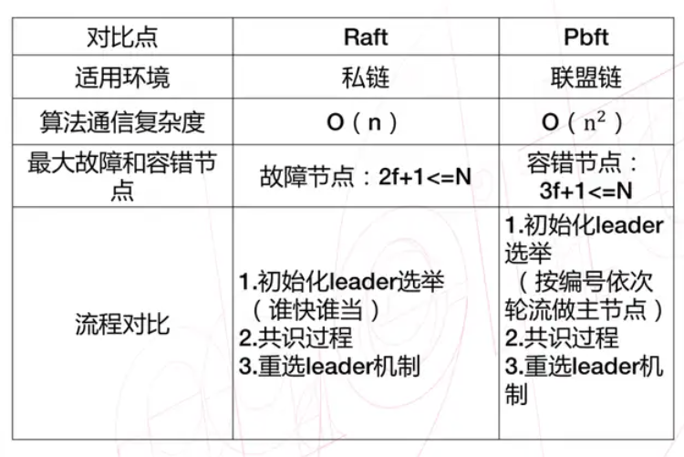

# PBFT

## 一、拜占庭将军问题

> 9位拜占庭将军分别率领一支军队要共同围困一座城市，因为这座城市很强大，如果不协调统一将军们的行动策略，部分军队进攻、部分军队撤退会造成围困失败，因此各位将军必须通过投票来达成一致策略，要么一起进攻，要么一起撤退。
>
> 因为各位将军分别占据城市的一角，他们只能通过信使互相联系。在协调过程中每位将军都将自己投票“进攻”还是“撤退”的消息通过信使分别通知其他所有将军，这样一来每位将军根据自己的投票和其他将军送过来的投票，就可以知道投票结果，从而决定是进攻还是撤退。
>
> 而问题的复杂性就在于：**将军中可能出现叛徒，他们不仅可以投票给错误的决策，还可能会选择性地发送投票**。假设9位将军中有1名叛徒，8位忠诚的将军中出现了4人投“进攻”，4人投“撤退”，这时候叛徒可能故意给4名投“进攻”的将军投“进攻”，而给另外4名投“撤退”的将军投“撤退”。这样在4名投“进攻”的将军看来，投票是5人投“进攻”，从而发动进攻；而另外4名将军看来是5人投“撤退”，从而撤退。这样，一致性就遭到了破坏。
>
> 还有一种情况，因为将军之间需要通过信使交流，即便所有的将军都是忠诚的，派出去的信使也可能被敌军截杀，甚至被间谍替换，也就是说将军之间进行交流的信息通道是不能保证可靠性的。所以在没有收到对应将军消息的时候，将军们会默认投一个票，例如“进攻”。

如果将军们在有叛徒存在的情况下仍然达成了一致，我们就称达到了“**拜占庭容错**”。

结论：如果存在$m$个叛将, 那么至少需要$3m+1$个将军, 才能最终达到一致的行动方案。

## 二、PBFT算法

### 1.共识算法

### 2.pbft 算法的基本流程

**时间复杂度**：Pbft算法的时间复杂度O(n^2)，在`prepare`和`commit`阶段会将消息广播两次，一般而言，Pbft集群中的节点都不会超过100。

`PBFT`算法中节点只有两种角色，主节点（`primary`）和副本（`replica`），两种角色之间可以相互转换。两者之间的转换又引入了视图（`view`）的概念，视图在`PBFT`算法中起到逻辑时钟的作用。

1. 客户端发送请求给主节点（由 `p = v[标识当前视图编号] mod n[主节点广播消息的一个唯一递增序号]`计算得出，轮流）
2. 主节点广播请求给其它节点，节点执行 `PBFT` 算法的三阶段共识流程。
3. 节点处理完三阶段流程后，返回消息给客户端。
4. 客户端收到来自 $F+1$ 个节点的相同消息后，代表共识已经正确完成。

**在PBFT中，如果满足 $N\ge 3F+1$，其中 $N$ 为总节点数，$F$ 为有故障的节点总数，那么最终一致性是可以达成的。**

> [!NOTE]
>
> **为什么`PBFT`算法只能容忍`(n-1)/3`个作恶节点？**
>
> 节点总数是`n`，其中作恶节点有`f`，那么剩下的正确节点为`n - f`，意味着只要收到`n - f`个消息就能做出决定，但是这`n - f`个消息有可能由`f`个是由作恶节点冒充的，那么正确的消息就是`n - f - f`个，为了多数一致，正确消息必须占多数，也就是`n - f - f > f`，但是节点必须是整数个，所以n最少是`3f+1`个。
>
> 或者可以这样理解，假定`f`个节点是故障节点，`f`个节点是作恶，那么达成一致需要的正确节点最少就是`f+1`个，当然这是最坏的情况，如果故障节点集合和拜占庭节点集合有重复，可以不需要`f+1`个正确节点，但是为了保证最坏的情况算法还能正常运行，所以必须保证正确节点数量是`f+1`个。

### 3.算法核心三阶段流程

算法的核心三个阶段分别是 `pre-prepare` 阶段（预准备阶段），`prepare` 阶段（准备阶段）， `commit` 阶段（提交阶段）。图中的C代表客户端，0，1，2，3 代表节点的编号，其中0 是主节点primary，打×的3代表可能是故障节点或者是作恶节点，这里表现的行为就是对其它节点的请求无响应。整个过程大致是如下：

首先，客户端向主节点发起请求，主节点 0 收到客户端请求，会向其它节点发送 pre-prepare 消息，其它节点就收到了pre-prepare 消息，就开始了这个核心三阶段共识过程了。

1. Pre-Prepare：主节点收到客户端发送来的消息后，构造`pre-prepare`消息结构体`< <PRE-PREPARE, v, n, d>, m >`广播到集群中的其它节点。
   1. `PRE-PREPARE`标识当前消息所处的协议阶段。
   2. `v`标识当前视图编号。
   3. `n`为主节点广播消息的一个唯一递增序号。
   4. `d`为`m`的消息摘要。
   5. `m`为客户端发来的消息。
2. Prepare：副本(`backup`)收到主节点请求后，会对消息进行检查，检查通过会存储在本节点。当节点收到 $2F+1$（包括自己）个相同的消息后，会进入`PREPARE`状态，广播消息`< <PREPARA, v, n, d, i> >`，其中`i`是本节点的编号。对消息的有效性有如下检查：
   1. 检查收到的消息体中摘要`d`，是否和自己对`m`生成的摘要一致，确保消息的完整性。
   2. 检查`v`是否和当前视图`v`一致。
   3. 检查序号`n`是否在水线`h`和`H`之间，避免快速消耗可用序号。
   4. 检查之前是否接收过相同序号`n`和`v`，但是不同摘要`d`的消息。
3. Commit：副本收到 $2F+1$（包括自己）个一致的`PREPARE`消息后，会进入`COMMIT`阶段，并且广播消息`< COMMIT, v, n, D(m), i >`给集群中的其它节点。在收到`PREPARE`消息后，副本同样也会对消息进行有效性检查，检查的内容是上文`1, 2, 3`。
4. Reply：副本收到 $2F+1$（包括自己）个一致的`COMMIT`个消息后执行`m`中包含的操作，其中，如果有多个`m`则按照序号`n`从小到大执行，执行完毕后发送执行成功的消息给客户端。

### 4.日志压缩

`Pbft`算法在运行的过程中，日志会不断累积的，但是在实际的系统中，无论是从日志占用的磁盘空间，还是新节点加入集群，同步日志的网络消耗来看，日志都不能无限的增长。

**`Pbft`采用检查点（`checkpoint`）机制来压缩日志。**为每一次操作创建一个集群中稳定检查点，代价是非常昂贵的，`Pbft`为常数个操作创建一次稳定检查点，比如每100个操作创建一次检查点，而这个检查点就是`checkpoint`，当这个`checkpoint`得到集群中多数节点认可以后，就变成了稳定检查点`stable checkpoint`。

当节点`i`生成`checkpoint`后会广播消息`<CHECKPOINT, n, d, i>`，其中`n`是最后一次执行的消息序号，`d`是`n`执行后的状态机状态的摘要。每个节点收到`2f+1`个相同`n`和`d`的`checkpoint`消息以后，`checkpoint`就变成了`stable checkpoint`。同时删除本地序号小于等于`n`的消息。

### 5.视图切换

在正常流程中，可以看到所有客户端发来的消息`m`都是由主节点`p`广播到集群的，但是当主节点突然宕机，又怎么保证集群的可用性呢？

`view-change`提供了一种当主节点宕机以后依然可以保证集群可用性的机制。`view-change`通过计时器来进行切换，避免副本长时间的等待请求。
当副本收到请求时，就启动一个计时器，如果这个时候刚好有定时器在运行就重置（reset）定时器，但是`主节点`宕机的时候，副本`i`就会在当前`视图`v中超时，这个时候副本`i`就会触发`view-change`的操作，将视图切换为`v+1`。

### 6.增删节点

1. 新节点启动以后，向网络中其他节点建立连接并且发送`AddNode`消息；
2. 当集群中的节点收到`AddNode`消息后，会广播`AgreeAdd`的消息；
3. 当一个节点收到`2f+1`个`AgreeAdd`的消息后，会发送`AgreeAdd`的消息给`Replica 5`
4. `Replica 5`会从收到的消息中，挑选一个节点同步数据，具体的过程在主动恢复中有说明，同步完成以后发送`JoinNet`
5. 当集群中其他节点收到`JoinNet`之后重新计算视图view，节点总数N，同时将PQC信息封装到`AgreeJoinOrExit`中广播
6. 当收到`2f+1`个有效的`AgreeJoinOrExit`后，新的主节点广播`UpdateNet`消息完成新增节点流程

### 7.与Raft

`PBFT`算法假设的环境又比`Raft`算法更加的“恶劣”，`Raft`算法只支持容错故障节点，而`PBFT`算法除了需要支持容错故障节点之外，还需要容忍作恶节点（**作恶节点节点是指可能对接收到的消息作出截然相反的回复，甚至伪造消息。**）。

