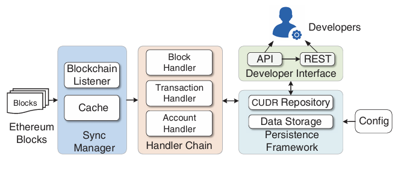
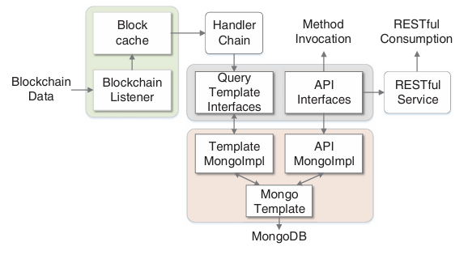
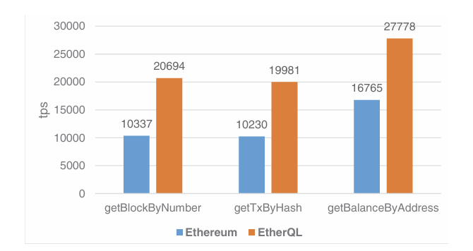

# EtherQL: A Query Layer for Blockchain System

[中文](EtherQL：区块链系统的查询层.md) | [English](EtherQL%20A%20Query%20Layer%20for%20Blockchain%20System.md)

Yang Li¹, Kai Zheng¹, Ying Yan², Qi Liu², and Xiaofang Zhou³
 

¹ School of Computer Science and Technology, Soochow University, China
 

² Microsoft Research, Beijing, China
 

³ The University of Queensland, Brisbane, Australia
 

**Abstract.** Blockchain - the innovation behind Bitcoin - enables people to exchange digital money with complete trust, and seems to be completely transforming the way we think about trust. While blockchain is designed for secured, immutable funds transfer in trustless and decentralized environment, the underlying storage of blockchain is very simple with only limited supports for data access. Moreover, blockchain data are highly compressed before flushing to hard disk, making it harder to have an insight of these valuable data set. In this work, we develop EtherQL, an efficient query layer for Ethereum – the most representative open-source blockchain system. EtherQL provides highly efficient query primitives for analyzing blockchain data, including range queries and top-k queries, which can be integrated with other applications with much flexibility. Moreover, EtherQL is designed to provide different levels of abstraction, which are suitable for data analysts, researchers and application developers.

## 1 Introduction

Cryptocurrencies such as Bitcoin and its successors, serve as a new form of digital currencies, facilitating instant payment to anyone in a decentralized manner [19]. As the underlying technology of cryptocurrencies, blockchain is a distributed ledger that records all the transactions and states in the entire network. Blockchain consists of a series of blocks that are chained together by keeping a reference to the previous block. A block is mainly composed of a block header, which holds the meta data of the block such as timestamp and the hash code of previous block, and a block body containing the corresponding list of transactions recorded in that block [25]. Each full node in the network maintains a copy of the ledger and various consensus algorithms such as Proof of Work [6], Proof of Stake [5] and PBFT [11] are adopted to achieve data consistency.

As a concept of architecture, Blockchain can be implemented in various ways. At current stage, there are two most influential blockchain platforms, Bitcoin [19] and Ethereum [25]. While Bitcoin gains its popularity for being the first decentralized asset transfer platform, Ethereum, as an extension of Bitcoin, is intended to implement a Turing-complete computation platform on top of blockchain for decentralized applications. A lot of applications such as asset transfer, Internet of Thing, clearing & settlement are implemented on Ethereum [10].

Ethereum stores the block data in a simple key/value data store (in most cases, LevelDB [21] is used). LevelDB is a fast in-process database with excellent writing performance, which has the ability to process a large amount of data and eliminates the need to run another database software separately. Block data are automatically compressed before synchronized to the disk, which makes LevelDB space-efficient.

Due to the limitation of LevelDB , the native implementation of the developer interfaces only supports limited queries, most of which are simply retrieving an item by its hash code. Moreover, since LevelDB organizes keys sequentially on disk, accessing values associated with keys requires random reading of the backed thousands of files scattered all over the disk, which is extremely time consuming. Therefore, LevelDB is not well suited for analytical applications that normally involve complex queries on the transaction data in a blockchain.

In this paper, we address the problem of efficient querying blockchain data by adding a query layer for a public blockchain system, where a set of useful analytical queries such as aggregation and top-k queries are supported. In view of rich Ethereum applications and ecosystem, we use Ethereum to demonstrate the feasibility of our prototype in this paper, while the proposed techniques can be applied to other blockchain instances as well. Our contribution can be summarized as follows:

1. We identify existing problem of efficient querying blockchain data and propose a query layer to support efficient analytical queries in blockchain system.
2. A range of analytical queries such as range query and top-k query are supported with flexible interfaces provided so that users can issue the query with both local API or RESTful service.
3. EtherQL automatically synchronizes new block data in a timely manner and store them in a dedicated database to ensure the query is both accurate and efficient.

The remainder of this paper is organized as follows. Section 2 reviews the recent development on Blockchain. Section 3 gives a brief introduction on the concepts and terminologies about Blockchain. Section 4 and Section 5 present the overview and details of the system design respectively. Section 6 and Section 7 provide detailed information of interfaces and report empirical evaluation results for different queries. Section 8 concludes this paper.

## 2 Related Work

Blockchain is a distributed ledger that is maintained by all participants. There are mainly two categories of blockchain systems. The first one is UTXO (Unspent Transaction Output) systems, such as Bitcoin [19] and Ripple [17]. Those systems records a UTXO set S. Each UTXO represents a fund that could be spent for future transactions. When new transaction comes, referenced UTXOs are removed from S. Those systems will verify the provided signatures of the transaction. If the signatures match the owner, those funds are claimed and transactions could add new UTXOs into S with funds. Thus, the applications of UTXO systems are restricted to fund transfer. The other one is account based such as Ethereum [25]. Each user is associated with an account that records relevant information such as balance, code and storages. A series of applications have been built based on blockchain technology, such as payment facility [10], health care [26], Internet of Thing [7] and file sharing [12]. However, due to limited query supports from the underlying LevelDB, it is not easy to query the blockchain data. There are some systems that provides basic query interfaces for blockchain data. For example, the Blockchain.info [1] wraps the Bitcoin’s block, transaction and address APIs to provide a RESTful service, which is convenient for developers to use. Project toshi [13] implements the Bitcoin protocols and backed by PostgreSQL, providing RESTful service for basic query operations and limited paging functionality. Etherscan [14] is an explorer and analysis platform powered by Ethereum foundation. Etherscan has a modified version of virtual machine that could be used to extract more information from blockchain, such as internal transactions. Etherchain [2] extends the Ethereum basic APIs and provides simple statistics, such as the block time and transaction count. Those systems could have rich information and provide users with basic interfaces to explore blocks, transactions and accounts. Nevertheless, more complex queries for blockchain data are not supported. For example, graph queries and top-K queries are not supported in those systems. Besides, utilization of these public APIs are restricted. Taking Etherscan for an example, the request to these API is limited to 5 requests/sec. In a word, those explorers are helpful for blockchain participants but not for data-driven applications.

There are a number of analytical tasks carried out by developers. [15] performs graph analysis with Bitcoin transactions. It is proven that Bitcoin is not a fully anonymous system with graph analysis. Rigorous quantitative analysis of Bitcoin transactions is carried out in [20]. Authors identify the transaction patterns that users employed to hide their identities. To detect money laundering, [18] proposes a multi-variant relation model with time series dataset. Besides, [8] builds a reputation network for blockchain users to reduce transaction risks. Those systems demonstrate the needs of scalable and efficient technique that can support data analytical tasks on top of blockchain systems.

## 3 Preliminary Concept

In this section we briefly introduce the concept of blockchain and how it works to reach consensus among participants. Our discussion is restricted to the most popular public blockchain platform, Ethereum, though other blockchain platforms adopt similar concepts and techniques.

### 3.1 Blockchain Architecture

There are mainly four layers in most blockchain systems, i.e. consensus layer, data layer, execution environment and hosted applications. The consensus layer is responsible for maintaining data consistency among all participants which tackles the Byzantine Fault Tolerance problem. The data layer contains the data structures and corresponding operations. The execution layer such as Ethereum Virtual Machine enables the runtime environment of Blockchain applications. At last, a rich classes of applications are implemented on top of that. The remaining discussion focuses on the data layer.

### 3.2 Blockchain Data Structure

Let us look at basic structure of block data. Without loss of generality, we omit minor details to avoid falling into complicated implementations of Ethereum, but readers can refer to the Ethereum yellow paper [25] for details. In the block header, there is a block hash chained with the previous block, a nonce that represents the proof of work in that block, and tree roots generated based on the information derived from the block body.

**State.** Accounts play a central role in Ethereum, which are referenced by the unique identifiers called addresses. In Ethereum, every account has their storage spaces, for maintaining the balances and other information. The state of all accounts is the state of Ethereum network that is updated when a new block is generated. Different from Bitcoin, Ethereum maintains the current state of all accounts in the modified version of Merkle tree [23], called Merkle Patricia tree/Trie [9], which is a mapping between addresses and account states. The Merkle tree root is stored in the block header as state root.

**Transaction.** The term 'transaction' is used in Ethereum to refer to the signed data package that stores a message to be sent from an account to another account in the blockchain network. A transaction mainly contains the following fields:

- Address of the sender and receipt of the transaction.
- Amount of value to transfer from the sender to the recipient.
- An optional data field, which may contain the message sent to the recipient.

The transaction root is the Merkle tree root of all transactions contained in that block.

**Receipt.** In order to serve as zero-knowledge proof and indexing for searches, execution environment concerning a transaction is encoded into a receipt. The transaction receipt is a tuple of four items comprising the transaction, together with the post-transaction state, the cumulative gas used in the block containing the transaction receipt as of immediately after the transaction has happened and a set of logs created through execution of the transaction. Merkle tree root of all receipts in the block is added to the block header as receipt root.

### 3.3 Storage with Trie

Ethereum adopts LevelDB as the backend data store to maintain blocks, transactions and accounts’ states. Basically, data structures are stored in Merkle Patricia tries/Trie. A Trie originates from radix tree, and Ethereum implementation introduces a few modifications to improve its efficiency. In a normal radix tree, a key is an actual path taken through the tree to get the corresponding value. That is, beginning from the root node of the tree, each character in the key tells you which child node to follow in order to get the corresponding value. Ethereum keeps the full current state in state Trie, updating accordingly with the execution of transactions. The key is encrypted to the SHA3 of the origin key to avoid DoS attack. Note that this actually makes it more difficult to traverse the tree and enumerate all the values.

## 4 System Overview

Fig. 1. System overview

The proposed architecture of the querying layer can be demonstrated in Fig. 1. We develop a middleware that automatically synchronizes blockchain data from Ethereum public network in real-time with a built-in Ethereum client, and provides developers or data analysts with an out-of-the-box data query layer for convenient access to the whole blockchain data. The layer consists of four modules: sync manager, handler chain, persistence framework and developer interface.

In order to keep up with the latest block data from other peers, our system continuously monitors block changes by setting up a blockchain event listener. Upon receiving a blockchain data, the event listener puts it in the cache to deal with unintentional forks in blockchain network, details of which can be found in Sect. 5.1. The handler chain continuously tries to get blockchain data from the cache and extracts the data into three kinds of data structures: block, transaction and account, with different data handler. We describe details of handler chain in Sect. 5.2. With the CRUD repository (short for creation, retrieval, updating and deletion) defined in Sect. 5.3, data is persisted to a different data storage that supports SQL queries. Both the data storage and the CRUD repository can be configured through the config module. Developer interface is built on top of the CRUD repository, which hides the complexity and provides easy access to blockchain data set. We will illustrate the detailed design of developer interface in Sect. 5.4. While the API module can be used directly to interact with the underlying data, REST [24] module offers more flexibility from maintenance and deployment perspective.

## 5 Design Details

### 5.1 Sync Manager

Due to the possible delay in the distributed network, more than one miners may broadcast their version of a new block before ‘hearing’ from others. This is when an unintentional consensus fork takes place. That means the data synchronized from other peers has the possibility of not being on the main chain. This problem is minor for Ethereum client because it provides limited interfaces and utilizes the Trie to maintain the state and recent changes are cached, making the overhead for switching to the main chain negligible. However, in relational databases undoing the operations concerning blocks, transactions and accounts states will bring about extra overhead and is also vulnerable to potential bugs. In order to deal with this inconsistent state without lowering the performance, we maintain a cache for incoming blockchain data before entering the handler chain. As a result, we can identify a potential fork in advance and reduce the chance of falling into forks. The number of blocks to be cached can be configured in the configuration module.

### 5.2 Handler Chain

The module handler chain can be viewed as a plugin to the Ethereum client, transforming incoming blockchain data to fit into SQL schemas. In the data structure in Ethereum, the latest state of all accounts are stored in the Merkle Patricia trees (Trie). Actually, the Trie structure is not contained in the raw blockchain data but built on the fly through execution of the transactions in the blockchain data. Ethereum clients continuously update their local view of the latest state if the execution result obeys the pre-defined consensus rules. Handler chain updates another SQL data storage just like Ethereum updates the Trie. The difference is that handler chain has to firstly extract the corresponding information from the transactions’ execution results according to the consensus rules. We divide the logical data structure of Ethereum Trie into three kinds of entities: block, transaction and account. As shown in Fig. 1, there are three components in *handler chain*: block handler that takes the incoming blockchain data as a whole and create new block entity, transaction handler that tracks the transaction list contained in current blockchain data and adds corresponding transaction entities, account handler that updates account entities to reflect the state changes described in Sect. 3.2. We chain all these handlers together [22], such that each handler undertakes its responsibility on passes the control to the next one until the blockchain data is properly processed. The main benefit of this design is that it decouples the blockchain data with the handlers so that we can dynamically add other handlers later on without affecting the client interface.

### 5.3 Persistence Framework

We intend to build a middleware for blockchain to facilitate efficient queries. To this end, it is of vital importance to provide a data persistence framework with the support of custom SQL, such as retrieving blocks with the block number in a specified range. On the one hand, raw blockchain data must be properly persisted to ensure scalability. On the other hand, custom queries must be performed efficiently on the storage to support enterprise-level applications. To support data persistence while maintaining the query flexibility, we adopt MongoDB as the external data storage to store the output result of handler chain. MongoDB [4] is an open source cross-platform NoSQL database with the support of flexible schema and can be easily configured for scalability. We have set up a default connection property for MongoDB instance but the configurations can be overridden in the configuration module.

We provide a level of abstraction above the diverse implementations of data storages so that support for other databases can be added in the following releases. In the center of data persistence framework is the CRUD repository, which is a bundle of SQL query templates. A query template encapsulates the data access interfaces exposed by the underlying data storage, and converts the function calls to real data manipulation operations. For example, the account template can be used to create an account, validate the existence of an account, update the balance, and delete an existing account.

### 5.4 Developer Interface

To meet different requirement of developers, we provide two types of interfaces, namely API and REST. While API is a native implementation of query interfaces, REST is a wrapper that provides RESTful services. The API module provides query interfaces for Ethereum accounts, transactions and blocks. More specifically, each module exposes 4 types of query interfaces: 1) Ethereum supported queries [3], 2) extended queries (eg. retrieving for transactions related to a specified account), 3) range queries (eg. listing transactions within a given time window, 4) top K queries (eg. top K accounts regarding the balance). Application developers can utilize these encapsulated interfaces without knowing all the details of underlying storage.

For front-end developers, it is not always feasible to know all the underlying technologies and learn how to prepare data before developing user interfaces. Therefore we wrap all the APIs above and build a high level developer interface in REST-like mode. The main purpose of integrating REST into our developer interface is that users of our system hold all the blockchain data, thus they can provide DaaS (Data as a Service) to serve applications on top of blockchain platform.

## 6 Implementation

Fig. 2. Implementation details of EtherQL

Joining in the Ethereum blockchain network requires implementation of the peer discovery protocol and blockchain synchronizing logics just like the Ethereum clients. In order to avoid re-inventing wheels, our system integrates EthereumJ [16], a pure-Java implementation of the Ethereum protocols.

As depicted in Fig. 2, **blockchain listener**, as the frontier of the system, is responsible for synchronizing blockchain data from EthereumJ in real time. The **block cache** maintains the latest *N* blocks and detects potential forks in the blockchain. When a fork takes place, it rebuilds the main branch. Considering blockchain’s immutability feature and tolerance of time delay, *N* is set to 5 by default, similar to the setting of go-ethereum, which is one of the most popular Ethereum clients.

**Handler chain** is composed of 3 sequential handlers that deals with a block from different perspectives. For example, the first block handler stores the basic block structure in underlying storage. In each handler, there is a **query template interface** that encapsulates a bunch of operations to manipulate the blockchain data. In the current release, we have implemented MongoDB version of the query template interface that encapsulates the **MongoTemplate**, a class that actually interacts with MongoDB.

The supported APIs are classified into five categories according to their functionality, each of which can be applied to three types of data, namely account, transaction and block. Table 1 lists the major APIs implemented by our system. Once developers add our system as a dependency to their application, they are capable of utilizing these interfaces to query the blockchain data. **REST service** is built to serve web applications, for instance, blockchain explorers. More details about the supported API interfaces have to be omitted due to space limitation and can instead be found on our project site hosted by GitHub^1^.

Note that both the query template interface and the API interface provide an abstraction to decouple our system with the underlying databases. The support for MySQL is still under development. Developers can realize the two interfaces to support other databases of their choice as well.

Table 1. API interface

|      Functionality      | Account |     Transaction     |           Block            |
| :---------------------: | :-----: | :-----------------: | :------------------------: |
|     根据...获取单个记录     | address |  transaction hash   | block hash or block number |
|     Range query by      | balance |  transaction value  |        block number        |
|      Aggregate by       |         | sender or recipient |           miner            |
|        Top K by         | balance |  transaction value  |                            |
| Paging (offset & limit) | balance |  transaction value  | block number or timestamp  |

## 7 Experiment Results

### 7.1 Experiment Setting

**Data Set** The raw blockchain data we use in this experiment is publicly available over the Ethereum homestead network. The data set contains approximately 2.7 million blocks, 850k accounts and 13 million transactions [14] since 2013. An account can be viewed as a tuple of `< address, balance, nonce, code, storage >`, where nonce is a decimal value indicating the number of transactions sent from this account and storage is where accounts utilize and maintain accounts’ inner states. Code stores compiled smart contracts [25], which is beyond the discussion of this paper. A transaction can be represented as `< hash, sender, receiver, value, gas, gas price, data, nonce >`. Gas in Ethereum serves as an incentive to charge transaction senders for transaction inclusion, while the gas price is set by transaction senders to indicate that they are willing to pay at most  $gas\times gas\ price$  for the execution of this transaction. The field data is encoded value of other arguments of this transaction and nonce is equal to sender’s nonce. The block is a collection of information which can be viewed as a tuple of `< hash, parent hash, number, miner, nonce, timestamp, transactions >` for simplicity. The field nonce is the outcome of mining procedure that indicates the amount of work of the miner. Detailed structure of the data set can be found on https://github.com/LeonSpark/EtherQL. 

**Environments** All the experiments are running on a PC (Intel Core I5 CPU of 8 cores, 3.2GHz for each core and 16GB memory on Ubuntu 14.04 LTS) with JDK 1.8 installed.

### 7.2 Performance Evaluation

Due to the fact that blockchain data are immutable, the process of synchronization is not repeatable unless synchronizing from scratch. Generally speaking, high-speed network bandwidth and fairly good performance of physical machine will speed up the synchronization process. Otherwise, it may take days to catch up with the other peers. Therefore we will not include evaluation of blockchain synchronization in this paper. Our evaluation is composed of two parts. First, we compare the throughput (following the common practice of 1s time interval) of our system against native Ethereum clients for supported queries. We adopt the latest go-ethereum(v1.5.4) clients and compare the throughput on three queries: 1) get a block by block’s number, 2) get a transaction by transaction’s hash and 3) get the balance of an account by its address. Please note that range queries and top-k queries are not tested since they are not supported by Ethereum client. We perform 10K queries in each thread and gradually increase the number of loading threads. The throughput in Fig.3 is the maximum number of all iterations. Then, we evaluate the performance of our system on query’s response time and concurrency.

Fig. 3. Throughput comparison between go-ethereum and EtherQL

**Throughput.** Fig.3 shows that the throughput in EtherQL is almost 2 times as that in go-ethereum. Ethereum’s lower throughput is partially due to the fact that only a single process (possibly multi-threads) can access the file at a particular time in Ethereum’s underlying LevelDB storage. Moreover, Ethereum uses hash as the key to locate the entity in the Trie, which involves unpredictable access of files scattered all over the disks. Both systems are capable of processing over 15K requests/s on account states because of the relatively smaller amount of accounts.

**Response time.** We query for a randomly selected list of accounts, transactions and blocks, and record how long it takes to complete the query. Since a single query usually completes in milliseconds, the reported time is the average of 10K independent queries to minimize the impact of random errors.

**Concurrency.** We increase the number of concurrent loading threads step by step and measure the time it takes to complete these queries. Each loading thread performs random lookups for different category of data and we calculate the average completion time. Table.2 lists the response time (in millisecond) of some representative API interfaces with increasing concurrent loading threads. The basic queries, such as retrieving an account by its address, are blinking fast. Response time grows with the incremental of concurrent threads but remains at a reasonable level. There is at least an order of magnitude gap in performance of retrieving a range of blocks compared to simply getting a block by its hash. However, considering a range query will retrieve 100 blocks, the average time cost for a single block is short. MongoDB’s indexes are used for retrieving top K accounts with the highest balance and transactions with the highest value, which significantly improves the performance. Note that MongoDB occupies memory space greedily if there exists sufficient amount of physical memory. However, if the data can just fit into the memory, MongoDB runs at high efficiency.

Table 2. Response time (in millisecond) of representative queries

<table style="margin: 0 auto;">
    <tr>
        <th rowspan="2">Category</th>
        <th rowspan="2">Typical Queries</th>
        <th colspan="5">Number of Concurrent Threads</th>
    </tr>
    <tr>
        <th>1</th>
        <th>10</th>
        <th>20</th>
        <th>40</th>
        <th>80</th>
    </tr>
    <tr>
        <td rowspan="2">Block</td>
        <td>Basic  By block number</td>
        <td>0.57</td>
        <td>2.303</td>
        <td>4.264</td>
        <td>5.146</td>
        <td>9.484</td>
    </tr>
    <tr>
        <td>Range Query  By block number(range 100)</td>
        <td>6.32</td>
        <td>25.28</td>
        <td>42.75</td>
        <td>67.15</td>
        <td>111.71</td>
    </tr>
    <tr>
        <td rowspan="2">Account</td>
        <td>Basic  By address</td>
        <td>0.517</td>
        <td>1.718</td>
        <td>3.744</td>
        <td>4.737</td>
        <td>7.999</td>
    </tr>
    <tr>
        <td>Top K  By balance rank(top 100)</td>
        <td>3.84</td>
        <td>13.85</td>
        <td>28.2</td>
        <td>39.5</td>
        <td>65.55</td>
    </tr>
    <tr>
        <td rowspan="2">Transaction</td>
        <td>Basic  By hash</td>
        <td>0.536</td>
        <td>2.077</td>
        <td>3.994</td>
        <td>6.666</td>
        <td>8.253</td>
    </tr>
    <tr>
        <td>Top K  By value rank(top 100)</td>
        <td>8.7</td>
        <td>28.5</td>
        <td>39.61</td>
        <td>59.83</td>
        <td>93.54</td>
    </tr>
</table>

## 8 Conclusion

Due to the limited query supports of the underlying data storage, blockchain data have not brought all its potential into full play. In this paper, we propose EtherQL, the first query layer (to our knowledge) for Ethereum blockchain data. EtherQL has a built-in java implementation of Ethereum consensus protocols, thus can be utilized to synchronize data from any Ethereum blockchain net-works. We also provide two levels of developer interfaces that can be used to retrieve data efficiently from blockchain or serve as a RESTful blockchain data provider. Experiments show the effectiveness and efficiency of EtherQL in
querying blockchain data.

## References

1. Blockchain.info. https://blockchain.info/.
2. Etherchain. https://etherchain.org/.
3. Ethereum main wiki. https://github.com/ethereum/go-ethereum/wiki.
4. Mongodb. https://www.mongodb.com/.
5. Proof of stake. https://en.bitcoin.it/wiki/Proof_of_Stake.
6. Proof of work. https://en.bitcoin.it/wiki/Proof_of_work.
7. A. Bahga and V. K. Madisetti. Blockchain platform for industrial internet of things. Journal of Software Engineering and Applications, 9(10):533, 2016.
8. M. Buechler, M. Eerabathini, C. Hockenbrocht, and D. Wan. Decentralized reputation system for transaction networks.
9. V. Buterin. Merkling in ethereum. https://blog.ethereum.org/2015/11/15/merkling-in-ethereum/.
10. V. Buterin et al. Ethereum white paper, 2013.
11. M. Castro and B. Liskov. Practical byzantine fault tolerance. In Symposium on Operating Systems Design and Implementation, pages 173–186, 1999.
12. L. Checker and A. Developers. Bitshare manager.
13. Coinbase. Toshi project. https://github.com/coinbase/toshi.
14. EtherScan. Etherscan.io. https://etherscan.io/.
15. M. Fleder, M. S. Kester, and S. Pillai. Bitcoin transaction graph analysis. arXivpreprint arXiv:1502.01657, 2015.
16. E. Foundation. Ethereumj project. https://github.com/ethereum/ethereumj.
17. R. Foundation. Ripple project. https://ripple.com/.
18. G. K. MCA and M. Prabakaran. An multi-variant relational model for money laundering identification using time series data set. Int. J. Eng. Sci, 3:43–47, 2014.
19. S. Nakamoto. Bitcoin: A peer-to-peer electronic cash system. Consulted, 2009.
20. D. Ron and A. Shamir. Quantitative analysis of the full bitcoin transaction graph.In International Conference on Financial Cryptography and Data Security, pages 6–24. Springer, 2013.
21. J. D. Sanjay Ghemawat. Leveldb github page. https://github.com/google/leveldb.
22. wikipedia. Chain of responsibility. https://en.wikipedia.org/wiki/Chain-of-responsibility_pattern.
23. wikipedia. Merkle tree. https://en.wikipedia.org/wiki/Merkle_tree.
24. wikipedia. Remote procedure call. https://en.wikipedia.org/wiki/Remote_procedure_call.
25. G. Wood. Ethereum: A secure decentralised generalised transaction ledger. Ethereum Project Yellow Paper, 2014.
26. X. Yue, H. Wang, D. Jin, M. Li, and W. Jiang. Healthcare data gateways: Found healthcare intelligence on blockchain with novel privacy risk control. Journal of medical systems, 40(10):218, 2016.