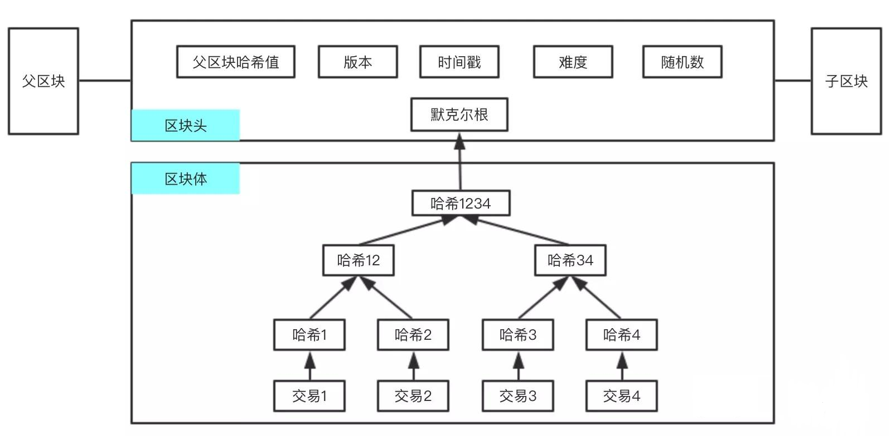
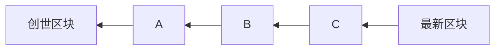
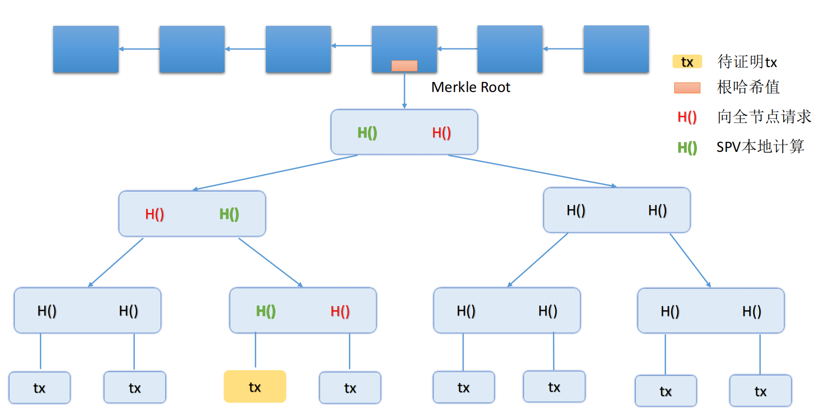

# 比特币中的数据结构详解

## 一、概述

比特币系统中使用的数据结构主要是以下两种：

- **哈希指针（hash pointers）**
- **默克尔树（merkle tree）**

哈希指针用于区块之间的连接作用，而默克尔树用于每个区块内部交易之间的连接作用。哈希指针与默克尔树的关系如下图所示：



## 二、哈希指针（hash pointers）

哈希指针用于区块与区块之间的连接作用，同时也为了保证区块内容不被篡改。

有计算机基础的都知道普通指针（计算机系统的内存指针），哈希指针跟普通指针很类似，只不过将普通指针中的地址换成了区块链中的哈希值。

**哈希指针（哈希值）存储在区块头中**

每个区块中会对整个区块计算哈希值，并存储在区块头中，每个区块头会存有上一个区块的哈希值，直到创世纪块（genesis block）。最近的一个区块也会取哈希值，存在区块链系统中。

比特币区块头域如下所示：

|     字段     |                描述                |
| :----------: | :--------------------------------: |
|     版本     |             区块版本号             |
| 父区块哈希值 |     区块链中上一个区块的哈希值     |
|   默克尔根   | 该区块中交易的`merkle`树根的哈希值 |
|    时间戳    |          该区块产生的时间          |
|   难度目标   |   该区块工作量证明算法的难度目标   |
|   `Nonce`    |     用于工作量证明算法的计数器     |

```cpp
class CBlockHeader
{
public:
    // header
    int32_t nVersion;		// 版本
    uint256 hashPrevBlock;  // 父区块的哈希值
    uint256 hashMerkleRoot; // Merkle 根
    uint32_t nTime;  		// 时间戳
    uint32_t nBits;			// （POW）难度目标
    uint32_t nNonce;		// 要找的符合 POW 的随机数	

    // 构造函数初始化成员变量
    CBlockHeader()
    {
        SetNull();
    }

    // 模板元实现序列化
    SERIALIZE_METHODS(CBlockHeader, obj) { READWRITE(obj.nVersion, obj.hashPrevBlock, obj.hashMerkleRoot, obj.nTime, obj.nBits, obj.nNonce); }

    void SetNull()
    {
        nVersion = 0;
        hashPrevBlock.SetNull();
        hashMerkleRoot.SetNull();
        nTime = 0;
        nBits = 0;
        nNonce = 0;
    }

    bool IsNull() const
    {
        // 难度为0说明区块还未创建，区块头为空
        return (nBits == 0);
    }
	
    // 获取哈希值
    uint256 GetHash() const;

    // 获取区块时间
    NodeSeconds Time() const
    {
        return NodeSeconds{std::chrono::seconds{nTime}};
    }
    
	// 获取区块时间
    int64_t GetBlockTime() const
    {
        return (int64_t)nTime;
    }
};
```

比特币中由哈希指针组成的链式结构如下：



由上图可看到，区块链系统中的的每个节点可以获得最近一个区块的哈希值H(recent block)，从而就可以追溯到创世纪块。

通过哈希指针的链式结构，也可以知道区块内容是否被篡改，因为只要某个区块A被篡改，它的哈希值就会改变，它之后区块B的哈希指针就不会指向A了，这样系统会很快知道A被篡改。或者篡改者从区块A一直改到最新区块，到最后最新区块的哈希值也会改变，跟系统中保存的最近区块哈希值H(recent block)对比，也就很快发现是否被篡改。

[https://www.blockchain.com/zh/explorer](https://link.zhihu.com/?target=https%3A//www.blockchain.com/zh/explorer) 可以看到最近区块的信息。

## 三、默克尔树（merkle tree）

默克尔树跟二叉树很类似，只不过把普通指针同样换成了哈希指针。

默克尔树在每个区块内部将各个交易连接起来了，如下图所示：



这个树的最下面是的叶子节点是区块体（`block body`）里的所有交易，每个交易取哈希值，相邻交易的哈希值结合起来一起取哈希，层层往上取哈希，直到得到最后一个哈希值，这个哈希值也就是根哈希值（`root hash`），并存在区块头（`block header`）。

从上面分析得到，只要记住了根哈希值（`root hash`），就可以检测出对树的任何节点的修改。要想改变其他节点的哈希值同时保证根哈希值的不变，就必须人为制造哈希碰撞，但通过哈希的性质知道，这是不可能的。

```cpp
class CBlock : public CBlockHeader
{
public:
    // network and disk
    // 区块中包含的所有交易
    std::vector<CTransactionRef> vtx;

    // Memory-only flags for caching expensive checks
    mutable bool fChecked;                            // CheckBlock()
    mutable bool m_checked_witness_commitment{false}; // CheckWitnessCommitment()
    mutable bool m_checked_merkle_root{false};        // CheckMerkleRoot()

    CBlock()
    {
        SetNull();
    }

    CBlock(const CBlockHeader &header)
    {
        SetNull();
        *(static_cast<CBlockHeader*>(this)) = header;
    }

    // 区块数据序列化
    SERIALIZE_METHODS(CBlock, obj)
    {
        READWRITE(AsBase<CBlockHeader>(obj), obj.vtx);
    }

    void SetNull()
    {
        CBlockHeader::SetNull();
        vtx.clear();
        fChecked = false;
        m_checked_witness_commitment = false;
        m_checked_merkle_root = false;
    }

    // 获取区块头信息
    CBlockHeader GetBlockHeader() const
    {
        CBlockHeader block;
        block.nVersion       = nVersion;
        block.hashPrevBlock  = hashPrevBlock;
        block.hashMerkleRoot = hashMerkleRoot;
        block.nTime          = nTime;
        block.nBits          = nBits;
        block.nNonce         = nNonce;
        return block;
    }

    // 区块对象格式化字符串输出
    std::string ToString() const;
};
```

### 3.1 默克尔树在比特币区块链中的作用

结论：作用就是提供`merkle proof`。

`merkle proof`是默克尔树内的从最底层的某个交易出发到最顶部根哈希的一条路径。如上图中最下面的黄色交易开始到最底部的路径就是一个`merkle proof`。

在比特币区块链网络中有很多节点，包括计算机、手机、矿机、服务器等等。在所有节点中分为：全节点和轻节点。

- 全节点（`full node`）：保存了区块的所有内容，区块头和区块体。（CBlock）
- 轻节点（`light node`）：只保存了区块头，比如手机中的比特币钱包。（CBlockHeader）

由于轻节点中没有存交易具体信息，那有这样一个场景该怎么办呢：

用户`A`转账给`B`轻节点用户，`B`如何知道此交易写入区块链了？或者说`A`如何向`B`证明交易已经写入区块链了？

为了解决上面问题，轻节点向全节点请求这个交易（上图中黄色标记的交易），全节点只需提供这个交易相关的哈希值（上图中红色标记的哈希值）即可。轻节点在本地根据这个交易的`merkle proof`计算出最后的根哈希值，然后对比本地区块头中的根哈希值是否一样，若一样，则证明此交易写入了区块链中。

### 3.2 证明某个交易不在区块链

虽然比特币区块链中没有这个需求，但我们可以思考下如何实现这样需求。

- 第一种方案：全节点将整个区块所有交易信息发给轻节点，这样可以证明某个交易不在区块中，但这是非常不高效的方法且比较笨的方法。

 - 第二种方案：

   思路还是根据`merkle proof`计算根哈希值，轻节点向全节点对这个交易发出请求，全节点为了证明此交易不在区块链中。

   - 全节点只需以下这样做即可：

     对区块中所有交易的哈希值进行排序，然后计算要证明的交易的哈希值，根据二分查找法来确定这个交易哈希值的位置，再将此位置相邻的2个交易`merkle proof`发送给轻节点。

    - 轻节点只需以下这样做即可：

      轻节点收到`merkle proof`后，根据`merkle proof`计算得到最后的根哈希值（`root hash`），若计算得到的根哈希值跟本地的区块头中的根哈希值比较一样，则证明此交易一定不在区块链中，因为如果在的话，最后计算出来的根哈希值比较必然是不一样的。

### 3.3 总结

通过上面可以看到，比特币区块链中数据结构的核心是哈希值，这样可以保证数据的不可篡改性，这也就符合区块链的性质（安全性、不可篡改性等）。

通过整个链的哈希指针和单个区块的默克尔树可以看到，区块链中设计的精妙之处，都是环环相扣的，正所谓牵一发而动全身，只要区块链一旦形成，很难改变。
