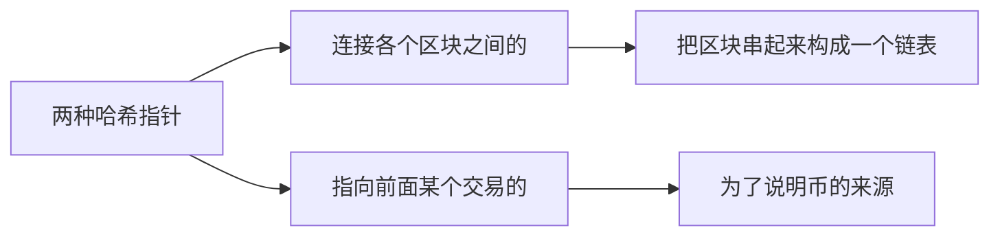
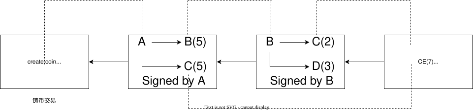
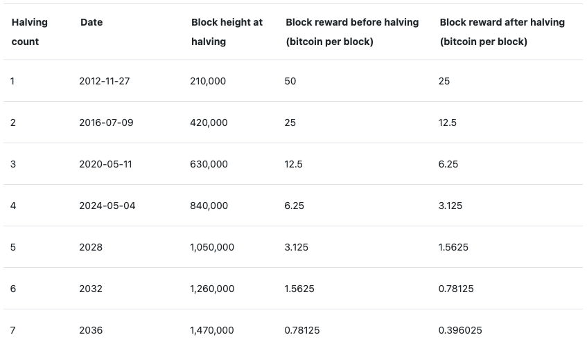

# 协议

## 一、双花攻击

数字货币的最大问题——双花

数字货币是一个文件，文件是可以复制的，面临着双花攻击的问题

- 中心化方案：

  央行维护一个数据库，每次交易内容都记录在数据库里

- 去中心化方案：

  - 谁发行 $\rightarrow$ 挖矿
  - 如何防范双花 $\rightarrow$ ​区块链

## 二、共识

如何防范双花攻击？建立共识机制！

所有的用户共同维护一个数据结构——区块链

例如一个用户 `A` 获得了铸币权，发行了10个比特币，把第一个交易写到区块链里，然后 `A` 给 `B` 和 `C` 5个比特币，而这个交易需要有 `A` 的签名，证明是经过 `A` 同意的。<font color="orange">比特币系统中都有输入和输出两部分：输入部分要说明币的来源（哈希指针）以及**A的公钥**，输出部分要给出收款人的公钥的哈希。</font>

```cpp
/** The basic transaction that is broadcasted on the network and contained in
 * blocks.  A transaction can contain multiple inputs and outputs.
 */
class CTransaction
{
public:
    // Default transaction version.
    static const uint32_t CURRENT_VERSION{2};

    // The local variables are made const to prevent unintended modification
    // without updating the cached hash value. However, CTransaction is not
    // actually immutable; deserialization and assignment are implemented,
    // and bypass the constness. This is safe, as they update the entire
    // structure, including the hash.
    
    // 交易的输入列表，每个CTxIn代表一个未花费的输出（UTXO）的引用
    const std::vector<CTxIn> vin;
    // 交易的输出列表，每个CTxOut包含接收地址和金额。
    const std::vector<CTxOut> vout;
    // 交易版本号
    const uint32_t version;
    // 锁定时间
    const uint32_t nLockTime;

private:
    /** Memory only. */
    // 是否包含隔离见证数据
    const bool m_has_witness;
    // 传统哈希
    const Txid hash;
    // 见证数据哈希
    const Wtxid m_witness_hash;

    // 计算传统哈希
    Txid ComputeHash() const;
    // 计算见证数据哈希
    Wtxid ComputeWitnessHash() const;

    bool ComputeHasWitness() const;

public:
    /** Convert a CMutableTransaction into a CTransaction. */
    explicit CTransaction(const CMutableTransaction& tx);
    explicit CTransaction(CMutableTransaction&& tx);

    template <typename Stream>
    inline void Serialize(Stream& s) const {
        SerializeTransaction(*this, s, s.template GetParams<TransactionSerParams>());
    }

    /** This deserializing constructor is provided instead of an Unserialize method.
     *  Unserialize is not possible, since it would require overwriting const fields. */
    template <typename Stream>
    CTransaction(deserialize_type, const TransactionSerParams& params, Stream& s) : CTransaction(CMutableTransaction(deserialize, params, s)) {}
    template <typename Stream>
    CTransaction(deserialize_type, Stream& s) : CTransaction(CMutableTransaction(deserialize, s)) {}

    bool IsNull() const {
        return vin.empty() && vout.empty();
    }

    const Txid& GetHash() const LIFETIMEBOUND { return hash; }
    const Wtxid& GetWitnessHash() const LIFETIMEBOUND { return m_witness_hash; };

    // Return sum of txouts.
    // 计算所有输出金额总和
    CAmount GetValueOut() const;

    /**
     * Get the total transaction size in bytes, including witness data.
     * "Total Size" defined in BIP141 and BIP144.
     * @return Total transaction size in bytes
     */
    // 返回交易总字节数（含见证数据）
    unsigned int GetTotalSize() const;

    // 是否是铸币交易
    bool IsCoinBase() const
    {
        return (vin.size() == 1 && vin[0].prevout.IsNull());
    }

    // 通过比较哈希值判断交易相等性
    friend bool operator==(const CTransaction& a, const CTransaction& b)
    {
        return a.hash == b.hash;
    }

    friend bool operator!=(const CTransaction& a, const CTransaction& b)
    {
        return a.hash != b.hash;
    }

    std::string ToString() const;

    bool HasWitness() const { return m_has_witness; }
};
```





以`A`转账给`B`的例子来说，`A`要知道` B`的地址（往哪里转账）；B要知道A的公钥（公钥验证签名）。

转账的具体流程：

1. A 的钱包挑选 UTXO

   - A 的钱包先扫描本地的 UTXO 集合，找到足够覆盖转账金额 + 矿工费的输入。
   - 假设 A 之前有一笔未花费输出 1 BTC，要给 B 转 0.3 BTC，它会选择这个 UTXO 作为输入。

2. 构造交易

   交易本质上是一个数据结构，包括：

   - `vin`：输入列表。每个输入引用一个之前的 UTXO（通过 `<txid, vout_index>`）。
   - `vout`：输出列表。这里会有一个输出给 B（0.3 BTC），另一个输出作为找零给 A 自己（0.7 BTC - 手续费）。
   - 版本号、锁定时间等。

3. 算出 txid 并广播
    交易序列化后做双 SHA256 得到 `txid`，A 的节点把交易广播到比特币网络的 P2P 节点。

4. 节点验证交易
    每个收到这笔交易的节点都会：

   - 检查引用的 UTXO 是否存在且没被花过。
   - 检查签名是否正确。
   - 检查输入金额 ≥ 输出金额 + 手续费。
   - 检查交易格式、脚本是否合法。

   通过验证后，交易进入节点的内存池，等待矿工打包。

5. 矿工打包到区块
    矿工会从内存池里挑选手续费高的交易，组成一个区块：

   - 区块里有交易列表，每笔交易只保存 `txid` 到 Merkle 树。
   - 区块头包含 Merkle root、前一区块哈希、时间戳、随机数等。
   - 矿工不断改变随机数寻找满足难度目标的哈希值（工作量证明）。

   一旦找到满足条件的区块哈希，矿工广播新区块。

6. 节点接收新区块

   - 节点验证区块头、工作量证明、区块里每笔交易。
   - 验证成功后，把区块加入本地区块链。
   - 更新 UTXO 集，把 A 的旧 UTXO 删除，加入新生成的 B 的 UTXO 和 A 找零的 UTXO。

   此时 B 的钱包也会检测到新 UTXO 属于自己，余额更新。

**如果B的同伙伪造一个交易： $B^\prime\rightarrow B$​，它用它自己的公钥在输入中说是它的公钥，自己的私钥签名，那么其他节点用假冒的公钥来验证以为是对的，有没有什么问题？**

铸币交易中有`A`的公钥的哈希（输出部分），转账交易中`A`的公钥要和铸币交易中的`A`的公钥对的上。


每个区块有很多个交易，他们构成`merkle tree`（上图只画了一个交易是做了简化）。

每个区块由块头和块身组成：

1. 块头里包含区块的一些宏观的信息：

   - 用的是比特币的哪个版本的协议

   - 指向前一个区块的指针（取哈希的时候是对块头取哈希，不包括块身）

   - 整棵`merkle tree`的根哈希值

   - 挖矿难度目标阈值`target`

   - 随机数`nonce`

2. 块身包含：

   - 交易列表

比特币系统中的节点分为

- 全节点：存储区块所有信息
- 轻节点：保存`block header`信息，没有办法独立验证交易的合法性

## 三、共识

### 1.分布式领域中的一些结论

- `FLP`：在一个异步系统里（网络传输时延没有上限），即使只有一个成员是有问题的，也不可能取得共识
- `CAP`：一致性、可用性、分区容错性，任何一个分布式系统，`CAP`最多满足其二

分布式共识的一个著名的协议：`Paxos`

它保证了一致性：如果达成了共识，那么这个共识一定是一致的。但是在某些情况下，`Paxos`协议可能一直无法达成共识。

### 2.比特币中的共识协议

要解决的问题：系统中可能有节点是恶意的

我们假设大多数节点是好的。

#### 2.1 直接投票

某个节点打包一个区块，将这个区块全网广播，其他节点收到后会核验这个候选区块，若正确则投赞成票，不正确则投反对票，正确票过半就添加到区块链中。

**女巫攻击**：某人恶意地不停产生账户（公私钥对）来控制投票。比特币系统中产生一个账户是很容易的，就是在本地产生一个公私钥对，不需要任何人批准（联盟链是可以使用直接投票达成共识的）

#### 2.2 通过算力来进行投票

尽管在你的服务器上可以创建很多账户，但是这不会使得算力提升。

**比特币中的共识机制就是工作量证明（Proof of Work），简称POW。**

恶意节点不断打包非法的交易广播到全网中是否可行？

POW 要求要找到正确的 nonce 值才能广播到全网中，而不断打包非法交易显然是对自己没有任何好处的，因为会消耗不小的经济成本，包括硬件设施、电力、维护等等。

#### 2.3 达成共识流程

通过 `POW` 如何在全网达成共识呢？

1. 每产生一个新的交易向全网广播。
2. 其他节点将收到的交易信息纳入一个候选区块中，并将其他很多交易一起打包在一起。
3. 其他节点都尝试在自己的候选区块中进行具有足够难度的工作量证明（`POW`）。
4. 当某个节点完成了工作量证明（`POW`），向全网广播此区块的完成结果。
5. 其他节点验证其完成结果。
6. 其他节点若验证通过，才能将此区块添加到区块链中。

#### 2.4 最长合法链

比特币中接受的区块应该是在最长合法链中

**分叉攻击**：通过向中间某个位置插入区块来回滚正常交易（查双花只会向前查）


区块链正常情况下也会出现分叉：两个节点同时获得记账权


会持续一段时间直到某个分叉先找到下一个区块。（何为认可？沿着你的区块向后扩展）

**交易流程**

1. A 给 B 转账 2W 元
   - A 的钱包生成一笔交易，把 2W 元支付给 B。
   - 交易广播到比特币网络，B 看到交易后交付电脑。
   - 这笔交易还没有被矿工确认很多个区块（假设只有 0~1 个确认）。
2. A 的同伙私自挖私链
   - 同伙用自己的算力，从 A 转账之前的区块开始，构造一条私有链。
   - 在私链上，A 的 2W 元仍然在自己账户里，没有支付给 B。
   - 私链继续挖出足够多的区块，长度超过主链。
3. 广播私链
   - 当私链比主链累计工作量大时，全网节点会认为私链才是“最长链”。
   - 原先的交易（A→B 2W 元）被区块链回滚，交易不再有效。

但是会有确认机制，比特币通常会有六个区块的确认，攻击者想回滚 6 个区块就必须重挖 6 个区块的 PoW，成本非常高。如果只等 0~1 个确认就交付实物，风险很高。

### 3.工作量证明的激励机制

#### 3.1 出块奖励

工作量证明难度是非常大的，那其他节点凭什么做这种大量的工作呢？

那就是比特币系统中的奖励机制，由于奖励是非常诱人的，所以工作量证明的过程也俗称为“挖矿”，这些挖矿的节点也俗称为“矿工”。

比特币系统中规定，只要工作量证明在全网达成共识并加入到区块链中后就可以获得比特币，也就是出块奖励。

比特币的来源就是通过出块奖励（`block reward`）产生，也是比特币增多的唯一来源。

#### 3.2 奖励规则

比特币系统中维持着平均每10分钟会有一个工作量证明成功（挖矿成功）。

比特币系统最初始的挖矿奖励是`50BTC`，区块链中的区块每21万个后奖励就减半，也就是`25BTC`，以此类推。

#### 3.3 计算`BTC`奖励减半的时间

根据2个条件：

1.平均每10分钟出一个块（挖矿成功）

2.每21万个区块后奖励减半

那么开采21万个区块所需的时间：

**21万 / （1/10） / 6 / 24 /365 =  3.995年**

计算得到时间为 3.995年，约等于4年。也就是说比特币奖励大约每4年减半。

#### 3.4 比特币奖励减半时间表


