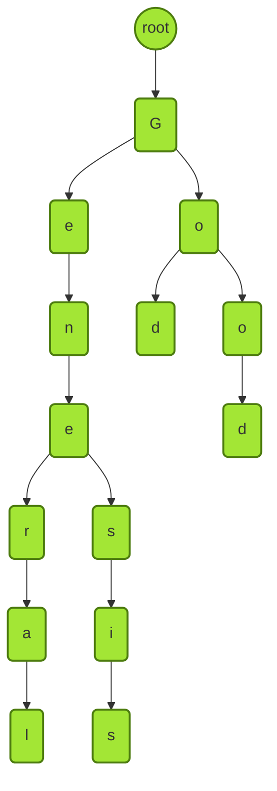
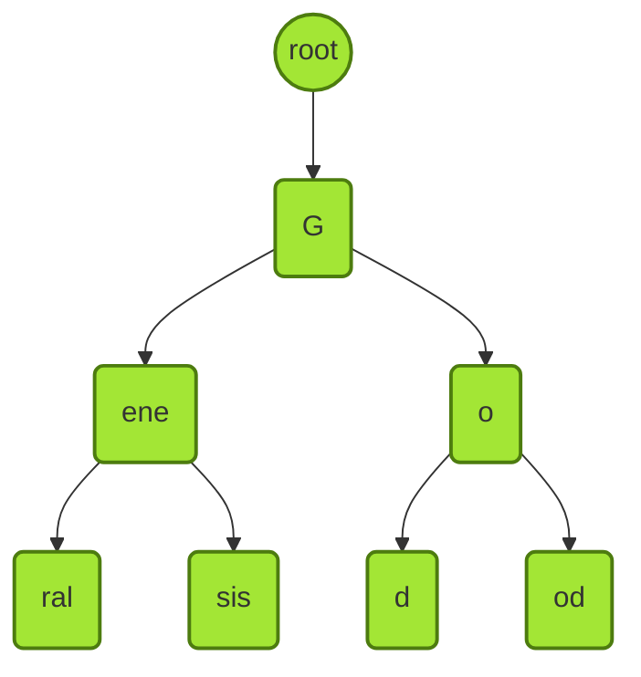
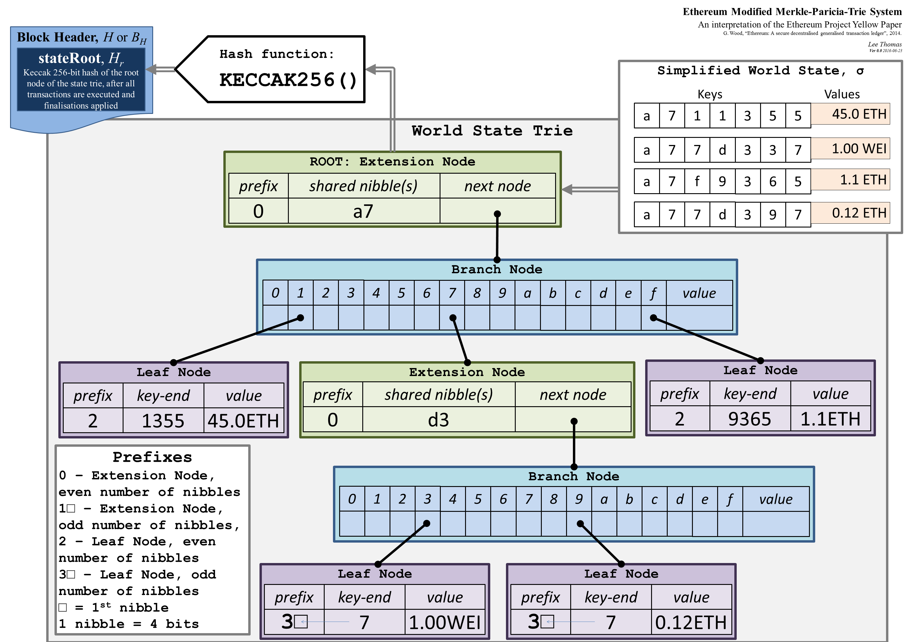
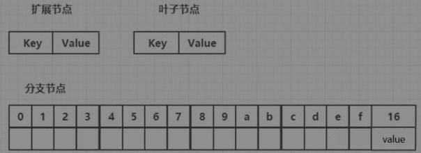

# 状态树

## 一、准备

以太坊中有三棵树，分别是状态树、收据树和交易树。

状态树是从账户地址到账户状态的映射。在以太坊中，账户地址为160字节，表示为40个16进制数额。状态包含了余额（balance）、交易次数（nonce），合约账户中还包含了code（代码)、存储（stroge）。

## 二、前缀树和压缩前缀树

### 1.前缀树

```tex
General
Genesis
Go
God
Good
```

下图为一个通过五个单词组成的 trie：




**特点：**

1. trie 中每个节点的分支数目取决于 Key 值中每个元素的取值范围（图例中最多26个英文字母分叉 + 一个结束标志位）。

2. trie 查找效率取决于 key 的长度。实际应用中（以太坊地址长度为 160byte）。

3. 理论上哈希会出现碰撞，而 trie 上面不会发生碰撞。

4. 给定输入，无论如何顺序插入，构造的 trie 都是一样的。

5. 更新操作局部性较好

6. trie 的缺点吗：

   trie 的存储浪费。很多节点只存储一个 key，但其“儿子”只有一个，过于浪费。因此，为了解决这一问题，我们引入 Patricia trie

   

### 2.压缩前缀树

还是之前那个例子：



需要注意的是，如果新插入单词，原本压缩的路径可能需要扩展开来。那么，需要考虑什么情况下路径压缩效果较好？树中插入的键值分布较为稀疏的情况下，可见路径压缩效果较好。
在以太坊系统中，160位的地址存在 $2^{160}$ 种，该数实际上已经非常大了，和账户数目相比，可以认为地址这一键值非常稀疏。

## 三、MPT

以太坊中针对MPT（Merkle Patricia tree）进行了修改，我们称其为MPT（Modified Patricia tree）



MPT包含四种不同的节点：

1. 扩展节点（Extension Node）：只能有一个子节点。
2. 分支节点（Branch Node）：可以有多个节点。
3. 叶子节点（Leaf Node）：没有子节点。
4. 空节点：空字符串。

每次发布新区块，状态树中部分节点状态会改变。但改变并非在原地修改，而是新建一些分支，保留原本状态。如下图中，仅仅有新发生改变的节点才需要修改，其他未修改节点直接指向前一个区块中的对应节点。

节点类型：



从上图看到，Key只在扩展节点和叶子节点中存在，分支节点中没有Key。Value用来存储节点数值的，不同的节点类型对应的Value值也会不同，主要如下几种情况：

1. 若节点类型是叶子节点，Value值存储的是一个数据项的内容。
2. 若节点类型是扩展节点，Value值存储的是孩子节点的哈希值。
3. 若节点类型是分支节点，Value值存储的是刚好在分支节点结束时的值，若没有节点在分支节点中结束时，Value值没有存储数据。